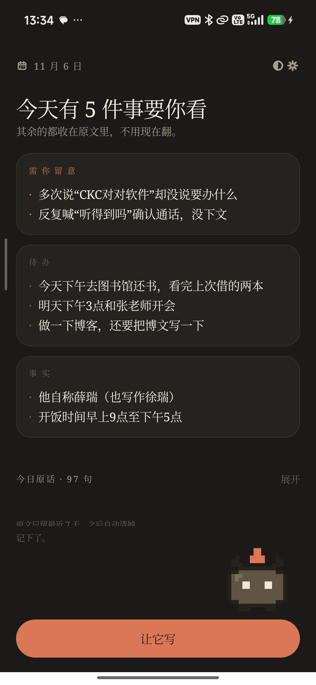
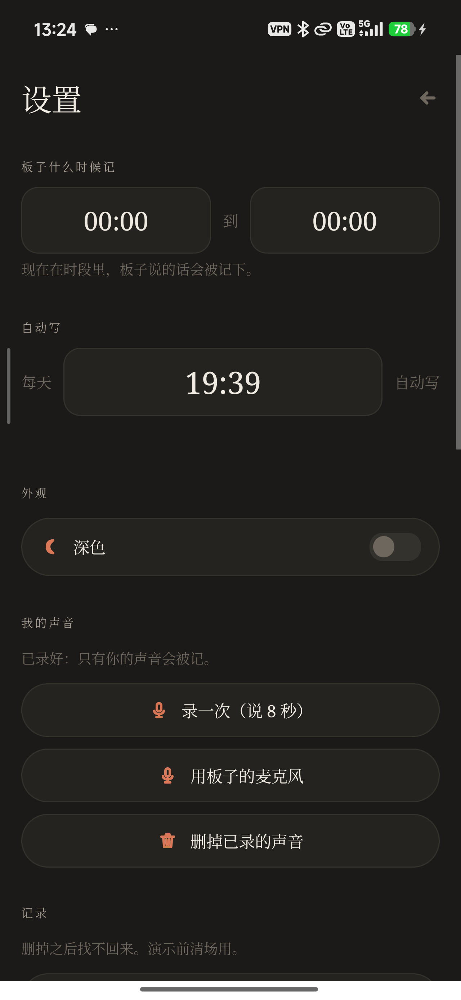
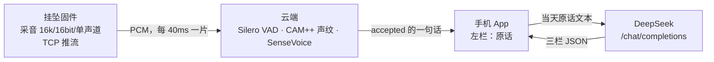

# 谛听

[](https://github.com/RUI-debug769/diting/actions/workflows/android-build.yml)
[](https://github.com/RUI-debug769/diting/releases/latest)
[](LICENSE)

一个只听你的记言器。

一块没有屏幕的挂坠挂在身上。它听得见周围所有人，但只把你自己的话记进你的账本。一天结束，它把这一天压成三栏：**事实、待办、需你留意**；再点一下，它把这一天写成一篇**志怪故事**——石兽伏在脚边，用你的原话，讲你的一天。原文一个字不改，收在下面，七天后自动清掉。

> 状态：2026-11-06，比赛版本（v0.1）。板子 → 云 → 手机的全链路已经真机跑通：主人说一句，左栏落一条（声纹 `0.661`，3.17 秒），旁人说不进账本，点「让它写」三栏出判断。2026-11-07 加了「写」：主屏顶部是两个页签「记 / 写」，「记」只放原话，「写」放三栏和按天的文章；文章在独立阅读页里按 80ms/字流出来。2026-11-07 又把界面重做成「暖纸质手帐」：日纸 / 夜纸两套，去掉卡片边框和药丸按钮；0.4 把「写」从网文改成按素材定字数的短篇小说。没做完的地方都写在「已知局限」里，不在别处美化。

| 主屏 | 设置 |
| --- | --- |
|  |  |

## 装到手机上

不想自己编译，直接拿现成的包：[Releases](https://github.com/RUI-debug769/diting/releases/latest) → `diting.apk`（v0.1，`com.diting.app`，`minSdk 26` / `targetSdk 34`，约 215 KB）。

> 注意：Releases 里的 v0.1 是上一版。仓库当前源码是 0.3（主屏顶部「记 / 写」两个页签，暖纸质手帐界面），新版要本地跑 `android/build_apk.sh`，产物在 `android/build/diting.apk`。CI 出包用的是现生成的 debug keystore，和本地 `debug.keystore` 签名不同，覆盖安装会报 `INSTALL_FAILED_UPDATE_INCOMPATIBLE`——装过 Release 包的手机要先卸载再装（卸载会清掉七天的记录）。装完在「设置」页最底部能看到「谛听 0.3 · 2026-11-07」。

1. 在手机上允许「安装未知来源应用」。
2. 装好打开，进设置页填云端地址（默认 `112.124.111.67:19002`）和 DeepSeek 的 Key。
3. 小米 / 红米报 `INSTALL_FAILED_USER_RESTRICTED` 时，改用 `adb install -r -i com.android.vending diting.apk`。

三点说明：包是 `debug.keystore` 签的（私钥不入库，CI 每次现生成），只适合装在自己机器上试用，正式分发给别人要换 release 签名；APK 不是提交进仓库的，由 GitHub Actions 跑 `android/build_apk.sh` 出包并挂到 Release；每次出包都会校验签名和版本号。

## 它不是什么

**不是录音笔。** 它不存音频，没有回放，也没有「昨天下午那段声音」可以翻。落盘的只有文字。

**不是聊天助手。** 它不回答问题、不查天气、不主动找你说话。你说，它记；它压成三栏，你可以不看。

**不是一个把大模型包了一层的套壳。** 左栏的字来自语音识别器（SenseVoice），不经过任何大模型，错字也原样留着。三栏才是大模型写的。这一点可以当场验证：把密钥删掉再点「让它写」，左栏照样有字，三栏退回规则兜底。

**不是端侧隐私。** 原始 PCM 会离开板子，走公网到我们自己的服务器。它在内存里被切句、比对声纹、转成文字，然后丢掉——不写盘、不留档。但「声音去了自己的服务器」和「声音没出门」是两句话，这里只说前一句。

**不是成品。** 两天半做出来的东西：能演示，不耐用。固件要外接供电、要连热点；云端是一台机器，没有冗余。

## 它是怎么连起来的

```
挂坠（T5AI-CORE） --原始 PCM--> 云（自建 ECS） --一句话的 JSON--> 手机
                                  切句 · 认人 · 转字              三栏 · 七天
```



三层各管一件事：

| 层 | 只做 | 不做 |
| --- | --- | --- |
| 固件 | 采音、推流、断线重连、20 秒没推出去就自己重启 | 不识别、不存、不判断 |
| 云端 | 切句、认人、转字，只把「主人说的话」推给手机 | 不渲染、不写三栏 |
| 手机 | 收话、存文字、按天归档、请求三栏 | 不碰声音 |

链路细节：板子每 40 ms 推一片 16k/16bit/单声道的 PCM，帧格式是 4 字节小端长度加数据，目标 `112.124.111.67:19001`（固件里写死）。云端用 Silero VAD 切成整句，CAM++ 声纹跟已注册的模板比（阈值 `0.48`，最多 3 个模板取最高分），SenseVoice int8 转字；BGM、掌声、笑声这类非语音事件直接丢掉。只有 `accepted` 的话才推到手机的 `19002` 端口。

手机收一句存一句，按天落盘。在「写」页点「让它写」（或到设置里那个自动整理时间）时，把当天原话一次性交给 DeepSeek；三栏先收进内存，再按 80ms 一个字放到屏幕上——不是网慢，是刻意放慢。

## 三分钟跑起来

### 你需要

- JDK 17
- Android SDK：`build-tools/34.0.0` 和 `platforms/android-34`
- 一台安卓手机，系统 8.0 以上（`minSdk 26`）。目前只在一台小米上装过。
- 要跑全链路：T5AI-CORE 板子、能烧录的电脑、TuyaOpen、一台跑 `cloud/` 的服务器。

### A. 只跑 App（没有板子也能看界面）

Release 里已经有包的话，这一节可以跳过；下面是从源码出包。

```bash
git clone https://github.com/RUI-debug769/diting.git
cd diting/android
printf 'sdk.dir=%s\n' "<你的 Android SDK 路径>" > local.properties
export JAVA_HOME="<你的 JDK 17 路径>"
export ANDROID_HOME="<你的 Android SDK 路径>"
./build_apk.sh
adb install -r build/diting.apk
```

`build_apk.sh` 只依赖 `android.jar` 和 build-tools，不拉 AndroidX；仓库里留着 Gradle 脚手架，这一版没有用它出过包。

小米、红米这类系统如果报 `INSTALL_FAILED_USER_RESTRICTED`，指定一个安装器身份就能过：

```bash
adb install -r -i com.android.vending build/diting.apk
```

装好之后：打开 → 设置里填云端地址（默认 `112.124.111.67:19002`）和 DeepSeek 的 Key。没有板子时，左栏会一直空着——这一版没有「说一句」按钮，声音只从挂坠来。

### B. 接上板子（全链路）

1. 手机开热点，名字改成 `Murdo`，密码填固件里编译进去的那个。
2. 云端：`cloud/deploy.sh`，装依赖、下载模型、起 `diting` 服务；`cloud/tools/enroll_push.py` 注册声纹。
3. 烧固件：`cd ~/tuya-ws/TuyaOpen/apps/diting && ../../.venv/bin/python ../../tos.py flash -p /dev/ttyACM0 -b 921600`（刷完板子自动重启）。
4. 板子上电，连上热点。App 底部出现「挂坠在线，正在听」。
5. 对着板子说话，左栏出现原话；让旁人说话，左栏不动。

`firmware/` 里是预编译的烧录包（含 2026-11-06 的 select 死等修复和残留配网旗子修复），源码在 TuyaOpen 工作区。

### C. 只看提示词

三栏的全部来源是 `android/app/src/main/java/com/diting/app/Lm.java` 里的 `SUMMARY_SYSTEM` 常量。把它和一条记录拼起来，贴给任何一个对话模型，你能看到它是怎么判断的，也包括它判断错的时候。「写」的提示词在同文件的 `ARTICLE_SYSTEM`，原文与参数见 [prompts/article.md](prompts/article.md)。

## 一条记录长什么样

手机上按天存一份，键是 `yyyy-MM-dd`：

```json
{
  "events": [
    {"mine": "记一下，明天下午三点和张老师开会。", "denied": false},
    {"mine": "今天下午去图书馆还书", "denied": false}
  ],
  "summary": {
    "facts": ["开饭时间早上9点至下午5点"],
    "todos": ["明天下午3点和张老师开会", "今天下午去图书馆还书"],
    "watch": ["开饭时间反复说了好几遍"]
  }
}
```

有「写」的那天，这条记录还会多一个 `article` 字段：篇名、正文（单篇；旧稿可能分章）和写入时间。它和三栏一样，七天随整份记录一起删；阅读页里点「重写」只留最新一版，旧稿不备份。

云端推给手机的一行 JSON 长这样：

```json
{"type": "utterance", "speaker": "me", "score": 0.661,
 "text": "记一下明天下午3点和张老师开会。", "duration": 3.17, "accepted": true}
```

三条规矩：

- 不存音频。任何字段里都不许出现音频路径、base64、二进制。
- `mine` 不做清洗。要修错字就另开字段，不要覆盖它。
- 七天前的天整份删掉，`summary` 一起删。

`schema/record.md` 是更早的一版逐条 JSONL 设计（给导出用的），App 现在按天存，字段含义不变。

## 写：把一天讲成一个故事

三栏是给白天的你用的：事实、待办、要留意。**「写」是给夜里的**：同一批原话，谛听用第一人称讲成一篇聊斋底色的短篇小说，称你为「你」。

主屏顶部是两个页签，两边各管各的：

- **「记」**：只有原话，一个字不改；日期、日历往回翻都在这儿。
- **「写」**：三栏判断，加一份最近七天的文章列表。底部那颗「让它写」也在这边。

写文章：在「写」页点某一天——写过就进阅读页，没写过就当场写那一天（往回七天都能补）。列表里每行显示篇名、字数和日期；兜底写的会标出来。
- **自动**：设置里的每天自动整理时间到点后，三栏和文章一起写。前台服务跑，通知栏显示「正在写今晚这一篇…」；写完一条通知：「整理好了 · 今晚写了《…》 · N 字」。
- **篇幅**：不再按「章」写。代码先去重原话，再按去重后的素材字数给区间：素材不到 600 字就写 700–1300，600–1500 写 900–1500，1500–3000 写 1200–2000，3000–6000 写 1800–2800，再多就 2500–3500。素材少就短，但不编。
- **每次不一样**：开头（一句原话 / 器物声 / 动作中途 / 第一个异常）和叙事手法（欧·亨利反转 / 海明威留白 / 契诃夫日常 / 鲁迅冷峻）各随机抽一条，底色固定聊斋志怪；同一批原话重写两次不会一模一样。
- **速度**：阅读页按 80ms 一个字往外放；追帧加速的阈值也放宽了，几百字的正常内容不会再被加速。点正文可以整篇跳过，往上滑就不再自动跟到底。
- **忠实**：只许用当天原话里出现过的人物、数字、地点、约定；风声、灯影、心理可以补，事实不许添，也不替你下结论。写坏了退回一段短兜底，页面和通知都会说明「这是兜底写的」。
- **存在哪**：和原话、三栏同一条 day JSON（`article` 字段），七天一起删。提示词原文见 [prompts/article.md](prompts/article.md)。

## 已知局限

**一、声纹只有一个模板时，阈值只能折中。** 主人 0.66 过，但背景音乐也被转成过「歌词」拿到 0.51–0.59。现在的办法是按 SenseVoice 的声学事件（BGM、掌声、笑声、哭、咳、喷嚏）先丢一轮，再比声纹；这挡得住音乐，挡不住一个嗓音接近的人。

**二、方言和口音取决于识别模型。** SenseVoice 对普通话好，方言看运气。我们没有做任何方言处理，也没有词表。

**三、板子不是可穿戴成品。** 它要连热点、要外接供电，外壳是手工挖的孔。演示时挂脖子上可以，日常戴一整天不行。

**四、云端是一台机器。** 没有冗余、没有队列，进程挂了链路就断。看门狗能让板子自己重连，但云不在了它也连不上。

**五、三栏的质量看模型当天的状态。** 提示词写得硬（最多几条、每条多长、宁可空不要凑），但同一个模型不同时候的判断差别不小。我们没有做过系统评测，也没有横向换模型比过。

**六、七天之后是真的删。** 没有导出、没有备份，删了找不回来。这是设计（忘记是功能），但也是风险。

**七、只在一台机器上试过。** 小米 HyperOS，机型代号 `25080RABDG`。换别的手机、别的系统，后台限制、权限弹窗都可能不一样。

**八、固件只开源了一半。** 仓库里是能直接烧的 bin，源码还在 TuyaOpen 的工作区，没并进来。你能验证它烧出来的行为，还不能自己改它。

**九、「写」的短篇质量看素材和模型。** 字数区间由去重后的素材量算出来，但模型有时仍会写超 10–20%；素材少的时候也可能把一篇写薄，或者把同一件事翻来覆去讲。提示词禁止新增人物、对话、器物，仍偶尔会把「音频／调试」漂移成具体道具（匣子、红线）——重写一次通常会变。我们没有做逐篇人工校订，也没有评测过「像不像小说」。自动写要跑几分钟，前台服务会常驻一条通知，耗电比只写三栏高；模型卡住时最多等 5 分钟，然后走兜底。

## 隐私

**存了什么。** 手机上只有文字：每天的原话、三栏判断、「那一篇」的正文，以及「有没有被否定」的标记。七天。

**发出去了什么。** 两段：一是板子推给云端的原始 PCM（切句、认人、转字用，内存里处理完就丢，不写盘）；二是点「让它写」或点开某一天写文章时，手机把当天原话文本发给 DeepSeek（三栏和文章是两次独立请求，发的是同一批文字）。请求里没有音频、没有通讯录、没有位置、没有设备号。

**没控制住的。** 两条。一是云端那一跳：PCM 走公网明文 TCP 到 `112.124.111.67`，链路上能抓包的人能听到原始声音——我们没有做传输加密。二是密钥：DeepSeek 的 Key 明文存在 App 私有目录里，手机被 root 或被拿走就不安全。

**删数据。** 设置 → 记录 → 清空今天的记录；或者等七天。原文、三栏和文章一起删，不留副本。

**立场。** 一个整天听你说话的设备必须开源，否则没人有理由信任它。开源不是为了让人读着放心，是为了让人能查：编译它、改它、看它到底发了什么。这也是为什么许可是 Apache-2.0。

## 仓库结构

```
diting/
├── README.md              你在这里
├── LICENSE                Apache-2.0
├── NOTICE
├── .github/workflows/     CI：跑 build_apk.sh 出包，tag 时发 Release
├── android/               安卓 App（Java，不依赖 AndroidX 的出包脚本）
│   ├── build_apk.sh
│   ├── gradle             脚手架（这一版没用来出包）
│   └── app/src/main/java/com/diting/app/
│       ├── MainActivity.java     主屏：三栏卡片 + 折叠原话 + 写入口
│       ├── ArticleActivity.java  「那一篇」阅读页：80ms/字、短篇排版、重写
│       ├── SettingsActivity.java 时段、声纹、记录、WiFi、云端与模型
│       ├── Store.java            按天存档（events + summary + article），七天清理
│       ├── Lm.java               三栏/文章提示词、请求、规则兜底
│       ├── Cloud.java            收云端推来的一句话
│       ├── NetRx.java            收板子的 PCM、算 RMS（备用通道）
│       ├── Enroll.java           声纹注册
│       ├── AutoWrite*.java       每天到点自动整理 + 写一篇（前台服务）
│       └── DayView.java          旧的两栏画布（已不挂到主屏）
├── cloud/                 云端：VAD + 声纹 + 识别（sherpa-onnx）
├── firmware/              预编译烧录包（源码待并）
├── hardware/shell/        外壳参数化建模，见 hardware/shell/README.md（STL/STEP 可再生成，不入库）
├── schema/                早期记录格式与示例
├── prompts/               提示词原文与实验笔记（三栏 + 写）
├── docs/                  设计、硬件、演示、问答、截图
└── out/                   更早的演示截图
```

## 许可

Apache-2.0，全文见 [LICENSE](LICENSE)。

可以商用，可以闭源改，要求保留版权声明和 `NOTICE`，附带一条专利授权。选它不选 GPL：这个项目希望被人拿回家改、装在自己家里，传染性许可会挡住一部分人；要防的只是「抹掉出处」，署名条款够用。

## 如何贡献

最需要四样东西：

1. 传输加密。PCM 现在是明文 TCP，这是隐私那一节最软的一条。
2. 更强的声纹。多模板、现场标阈值，宁可漏记，不可错记。
3. 方言词表。一个词一条：怎么写、怎么读、普通话怎么说、谁教的、哪里的话。
4. 外壳。现在是手工挖的孔。

提 PR 的话：一个 PR 一件事；新增依赖要说清楚为什么，尤其是要联网的；不要提交真实录音、真实日记、`debug.keystore`、`local.properties`、模型权重。

## 待核实

1. 换一台非小米的手机，后台收流能撑多久。
2. 板子连续推流能撑多久不断——目前最长只跑过半小时。
3. 三栏提示词在别的模型上是什么表现，没有横向比过。
4. 方言可用度：没有样本，说不清，别在会上给百分比。
