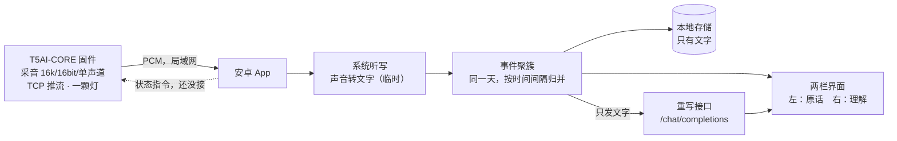

# 谛听 · 开源发布物

这份文档是发布素材的汇总，四块可以分开取用：仓库 README 的正文、一条 200 字以内的发布文案、评委与记者可能会问的八个问题、仓库目录的建议。最后附一份发布前要核实的清单。

写的时候守三条：不编数字，不写"首创""第一"这类词，没测过的地方写"待核实"。

---

## 一、README 正文

以下可直接作为 `README.md`。

---

# 谛听

一个只听你的记言器。

白天，它把你说的话按事件记成两栏：左边是你的原话，一个字不改；右边是它用自己的口吻写的理解。夜里，它把这一天重写成一篇日记。你可以否定任何一条，它会记住，下一次改口。

> 状态：比赛版本。能编译、能安装、能演示；板子到手机的音频链路还在联调，语音识别暂时借用系统听写。没做完的地方都写在「已知局限」里，不在别处美化。

## 它不是什么

**不是录音笔。** 它不存音频，没有回放，也没有"昨天下午那段声音"可以翻。落盘的只有文字。

**不是全天候监听。** 这一版是你按下"说一句"它才开始转文字，App 不在后台一直听。"一直在听"是设计目标，不是现在的状态。

**不是聊天助手。** 它不回答你的问题、不查天气、不主动找你说话。你说，它记；它写，你可以不认。

**不是一个把大模型包了一层的套壳。** 左栏没有经过任何模型：那句话是识别器的输出，错字也在里面。右栏才是它的话。两栏的差别来自机制，不来自提示词风格。这一点可以当场验证：把密钥删掉，左栏照样有字——它走的是识别器，不是那个写话的模型。

**不是成品。** 两天半做出来的东西。链路还在联调，声纹没做，方言的覆盖取决于你手机上装了什么。它现在最完整的部分是那几个取舍，不是完成度。

## 它是怎么连起来的

数据从麦克风到日记只有一条线：

```
麦克风 → 板子（采音、推流、一颗灯） → 手机（转文字、聚簇、存文本、两栏） → 云端（只重写）
```



三层各管一件事，谁也不越界：

| 层 | 只做 | 不做 |
| --- | --- | --- |
| 固件 | 采音，把 PCM 推给手机；点灯 | 不识别、不存、不联网 |
| 手机 | 收流、转文字、聚簇、存文本、两栏 | 不重写 |
| 云端 | 只收文字，只写右栏那一句 | 不碰声音 |

链路细节：板子作客户端连手机热点，端口默认 8765；每帧是 4 字节小端长度加 PCM（16k、16bit、单声道）。这条线现在是单向的：板子推音频，手机收，App 里只有接收端；手机反向发状态给板子那一段还没写，所以灯不受 App 控制。灯是固件的：一颗单色灯用亮灭的节律表示待机、在听、听到别人、被否定、夜间书写、断连六件事。

灯只有一种颜色，这不是省事。七色灯是音箱和路由器的语言，一颗单色的灯在呼吸，才像活的东西。

为什么是 TCP 不是蓝牙：原始 PCM 一秒 32 KB，蓝牙那点吞吐要先做压缩、分包、重传，两天半的预算会把大半押在链路上。局域网一条 TCP 就够，而且这条线根本不出门。

## 三分钟跑起来

### 你需要

- JDK 17
- Android SDK：`build-tools/34.0.0` 和 `platforms/android-34`
- 一台安卓手机，系统 8.0 以上（`minSdk 26`）。目前只在一台小米上装过，见文末。
- 可选：T5AI-CORE 板子、一台能烧录的电脑、TuyaOpen。

### A. 只跑 App（不需要板子）

```bash
git clone <仓库地址>
cd diting/android
printf 'sdk.dir=%s\n' "<你的 Android SDK 路径>" > local.properties
export JAVA_HOME="<你的 JDK 17 路径>"
export ANDROID_HOME="<你的 Android SDK 路径>"
./build_apk.sh
adb install -r build/diting.apk
```

`build_apk.sh` 只依赖 `android.jar` 和 build-tools，不拉 AndroidX。仓库里留着 Gradle 脚手架，但这一版没有用它出过包。

小米、红米这类系统如果报 `INSTALL_FAILED_USER_RESTRICTED`，指定一个安装器身份就能过：

```bash
adb install -r -i com.android.vending build/diting.apk
```

装好后：

1. 打开，给录音权限。没有权限时会转到手动输入，也能用。
2. 点"说一句"，说一句完整的话。左栏出现原话，一个字不改。
3. 点"让它写"。右栏出现它的话。没填密钥也能点，这时走的是本机兜底句式——你会看到右栏有字，但那不是模型写的，状态行会说明。
4. 点"这不是我说的"，最近一条已经写过的会被划掉。下一次重写时，这句话会带着"这句被否认过，请换一种说法"一起交回去。
5. 长按顶部的日期，打开设置：Key、模型、接口（留空就用 DeepSeek 的默认地址）。

### B. 接上板子（可选，这一版只验证链路）

1. 手机开热点，记下热点名、密码，以及手机在热点里的地址。
2. 固件里填四个值：热点名、热点密码、手机地址、端口（默认 8765，要和 App 里的一致），然后 `tos.py build`、`tos.py flash`。
3. 板子上电。App 状态行出现"板子接上了（地址）"；对着板子说话，KB 数和音量会动。
4. 到这一步为止，板子的话还没有进识别。转文字用的仍是手机自己的麦克风——这条写在局限第二条，不藏。

### C. 只看提示词

右栏那句话的全部来源，是 `android/app/src/main/java/com/diting/app/Lm.java` 里的 `SYSTEM` 常量。把它和一条记录拼起来，贴给任何一个对话模型，你能看到它是怎么写出来的，也包括它写坏的时候。仓库里计划把这段单独抽到 `prompts/rewrite.md`，现在还没有抽。

### 要填的占位符

| 占位符 | 填什么 | 在哪 |
| --- | --- | --- |
| `<仓库地址>` | 这个仓库的 git 地址 | 命令行 |
| `<你的 Android SDK 路径>` | SDK 根目录，里面要能看到 `build-tools/34.0.0` | `android/local.properties` 的 `sdk.dir`，以及 `ANDROID_HOME` |
| `<你的 JDK 17 路径>` | JDK 17 的根目录，不是 `bin` | 环境变量 `JAVA_HOME` |
| `<API Key>` | 你自己申请的密钥，形如 `sk-...` | App 里长按日期 → 设置 → Key |
| `<接口>` | 兼容 `/chat/completions` 的地址，默认 `https://api.deepseek.com/chat/completions` | 同上 |
| `<模型名>` | 默认 `deepseek-chat` | 同上 |
| `<热点名>`、`<热点密码>` | 手机热点的名字和密码 | 固件的网络配置 |
| `<手机地址>` | 手机在热点里的地址，常见 `192.168.43.1` 或 `192.168.232.1`，以你手机为准 | 同上 |
| `<端口>` | 默认 8765，两端必须一样 | 固件与 `NetRx.java` 的 `PORT` |

## 一条记录长什么样

一天一个文件，一行一条，UTF-8。五个字段都要有；`rewrite` 是唯一可以为 null 的。

| 字段 | 类型 | 说明 |
| --- | --- | --- |
| `ts` | 字符串 | 说这句话的本地时间，ISO 8601 带时区偏移，精确到秒 |
| `event` | 字符串 | 事件簇 id，形如 `日期-两位序号`。同一件事里的几句共用一个 id。当前 App 的规则是：两句之间隔不超过 90 秒算同一件事，阈值在 `MainActivity.EVENT_GAP_MS`，可以改 |
| `original` | 字符串 | 原话。识别出来什么样就存什么样：错字、断句、语气词，一个都不改。改了就不是证据了 |
| `rewrite` | 字符串或 null | 谛听写的那句。null 表示还没写。它必须用第一人称、必须引到原话里的具体词，不确定就说不确定 |
| `denied` | 布尔 | 用户有没有否定过。只标记，不删这一条；当前 App 会把右栏换成一句占位话，见已知局限第五条 |

示例三条（编的，不是谁的日记）：

```json
{"ts":"2026-11-05T09:41:12+08:00","event":"2026-11-05-01","original":"今天那个会又拖到十二点，他们第三次讲同一页 PPT。","rewrite":"你把那场会记成了三次重复。你烦的不是拖堂，是他们讲的跟你记得的不一样。","denied":false}
{"ts":"2026-11-05T14:03:55+08:00","event":"2026-11-05-02","original":"这个方案我觉得不行，但是我说不上来哪儿不行。","rewrite":null,"denied":false}
{"ts":"2026-11-05T22:10:07+08:00","event":"2026-11-05-04","original":"算了，明天再说。","rewrite":"你说算了的时候，通常不是算了。","denied":true}
```

三条规矩：

- 不存音频。任何字段里都不许出现音频路径、base64、二进制。
- `original` 不做清洗。要修错字就另开字段，不要覆盖它。
- 导出、备份、迁移都以这个格式为准。App 内部怎么存是另一回事。

## 已知局限

**一、语音识别用的是系统听写。** 这一条最要紧。安卓的 `SpeechRecognizer` 不用密钥、不用下模型，今天就能听见；但它把音频交给谁——手机本机的识别服务，还是厂商的云端——由系统决定，不由我们决定。所以我们无法审计它，也不能承诺这一段音频不出手机。这是当前版本离"可验证的隐私"最远的地方。要补上，得改成从板子取流、在端上跑识别模型。代码里的接口是按这个前提留的（`Asr` 只有一个 `onText` 出口），但换实现这件事没做。

**二、板子到手机的音频还没有进识别。** 链路是通的：板子把 16k/16bit/单声道的 PCM 推过来，App 收得到，能算音量、能显示"板子在线"。但这段音频目前只走到"电平"这一步。转文字用的还是手机自己的麦克风。而且这条线是单向的：手机收得到，发不回去。所以现在拔掉板子功能不少，接上板子多的是一个在线指示和几个数字。

**三、没有声纹。** 谁拿你的手机说话，它都会记成你说的。现在靠"你按一下它才听"来近似"只听你一个人"。这是设计里最重要的一道闸门，没有做。

**四、方言支持有限。** 识别对方言的覆盖取决于你手机上的听写服务，我们没有做任何方言处理。项目里也没有方言词表——那是设计里最想要的一块，还没写。

**五、存储是最简形态。** 一天的记录存成一段 JSON，只用了三个字段：原话、重写、是否被否定。`ts` 和 `event` 在格式里定义了，App 里还没落盘。没有数据库、没有导出、不能跨设备。`denied` 现在的表现也很粗：那条的右栏直接换成"（你说这不是我说的）"，原句不留。

**六、不能全天候。** 没有常驻前台服务。App 退到后台或者息屏一段时间，收流会断，板子那边看到的就是断连。

**七、重写看模型当天的状态。** 提示词写得比较硬：必须引具体名词、不许替人下判断、只输出 JSON。但同一个模型不同时候写出来的东西差别不小。我们没有做过系统评测，也没有横向换模型比过。写坏了只有兜底句式保底，不让右栏空着——保底能看，但不等于写得好。

**八、只在少数机器上试过。** 具体机型与系统版本待核实。国产系统的后台限制没有逐个处理，换一台手机可能要重新调。

## 隐私

**存了什么。** 只有文字。App 落盘的是原话、重写、是否被否定三项。它不保存音频：系统听写拿走的那段我们拿不到；板子推过来的 PCM 只用来算音量，算完就丢。没有录音文件，没有回放。

**发出去了什么。** 只有你点"让它写"的时候，App 才把当天的原话文本发出去。请求里没有音频、没有通讯录、没有位置、没有设备号。我们没有中转服务器，也没有收集端：请求从你的手机直接发到你填的那个地址。

**没控制住的。** 两条。一是系统听写那一步（见局限第一条），音频会不会离开手机由手机厂商决定。二是密钥：它明文存在 App 的私有目录里，没有加密。手机被人拿走或者被 root 了，它就不安全。

**板子。** 固件只连手机热点、只往手机推流，不访问公网。你可以把它自己编译一遍，然后看着流量表确认它没联网。这句话是整份文档里最值得被验证的一句。

**立场。** 一个整天听你说话的设备必须开源，否则没人有理由信任它。开源不是为了让人读着放心，是为了让人能查：编译它、改它、看它到底发了什么。这也是为什么许可是 Apache-2.0，而不是"保留一切权利"。

**删数据。** 卸载 App，记录就没了。想留得久，得等导出功能，现在还没有。

## 许可

Apache-2.0，全文见 `LICENSE`。

可以商用，可以闭源改，要求保留版权声明和 `NOTICE`，附带一条专利授权。选它不选 GPL：这个项目希望被人拿回家改、装在自己家里，传染性许可会挡住一部分人；要防的只是"抹掉出处"，署名条款够用。

## 如何贡献

最需要四样东西：

1. 把识别从系统听写换到端上。这是第一优先，换掉之后隐私那一段才能写硬。
2. 声纹。阈值只能现场标，宁可漏记，不可错记。
3. 方言词表。一个词一条：怎么写、怎么读、普通话怎么说、谁教的、哪里的话。
4. 外壳。现在是手工挖的孔。

报 issue 之前先看一眼「已知局限」。听写这件事不归我们管、不能离线、没有声纹，这三条是已知的，不用再报一遍。

提 PR 的话：

- 一个 PR 一件事。
- 新增依赖要说清楚为什么，尤其是要联网的——这个项目对"多一条出网路径"很敏感。
- 不要提交真实录音、真实日记、`debug.keystore`、`local.properties`、模型权重。要举例就用自己编的句子，像上面那三条一样。
- 提交信息中文英文都行。

只有一个人在维护，回复会慢，见谅。

---

## 二、发布文案（200 字以内）

标题（魔搭发帖用，不计入字数）：**《谛听：它只记话，不记声音》**

正文：

> 谛听是一个记言器。白天它把你说的话记成两栏：左边原话一字不改，右边是它用自己的口吻写的理解。夜里重写成日记，你可以否定任何一条，它会记住并改口。
>
> 硬件是一块涂鸦 T5AI-CORE 加一颗灯。固件、安卓端、数据格式、重写提示词全部开源，Apache-2.0。只存文字，不存声音。
>
> 两天半做的，板子和手机的链路还在联调，声纹还没做。局限都写在仓库里，不藏。

实测 173 字（含标点，不含标题与空格），离 200 字还有余量。朋友圈发的时候可以只留前两段，第三段放评论。

## 三、评委与记者可能问的八个问题

回答按 20 秒准备，每条 80 字上下。现场语速慢一点，别背，说漏了就直接说"这条没做"——回避比没做更难看。

**1. 开源了别人抄走怎么办？**

抄得走，Apache-2.0 允许。要防的不是抄，是抄了还说是自己写的，署名和 `NOTICE` 就是干这个的。而且这作品的重量不在代码量，在取舍：左栏一个字不改、否定要真的记住。这些抄不走。

**2. 数据存在哪？会不会上传？**

文字存在手机里，一段 JSON。点"让它写"的时候，原话会发到你填的那个模型地址，只有文字，没有音频。我们没有服务器，请求不经过我们。密钥也在你手机上，明文存的，这点得说清楚。

**3. 能不能离线跑？**

整条不能。转文字用系统听写，可能联网；重写要调模型。板子那头本来就不联网。设计上的离线版是端侧识别加端侧小模型，没做。现在说"离线"是不诚实的。

**4. 为什么用 Apache-2.0，不用 GPL？**

想让人拿回家改、装在自己家里，GPL 的传染性会挡住一部分人。代价是允许闭源商用，我们接受。它要求保留版权和 `NOTICE`，还带一条专利授权——真要防别人拿这段代码去申请专利反咬，这条比"开源"本身有用。

**5. 有没有训练自己的模型？**

没有。一个模型都没训。用的是系统听写加现成的对话模型。我们做的是流程、提示词、数据格式，和那些取舍。说"自研模型"是撒谎，不如说清楚我们做了什么。

**6. 没有声纹，"只听你"是不是假的？**

是近似。你按一下它才听，所以它没在偷听别人；但别人拿你的手机说话，它也会记成你说的。声纹是下一步，阈值只能现场标，宁可漏记不可错记。这条写在 README 第三条局限里。

**7. 和录音笔加大模型有什么区别？**

录音笔录声音，它不录。录音笔的"总结"是一次改写；它的左栏一个字都不动，右栏才是它的话。差别来自机制，不是提示词风格。你能指着左边说这是证据，指着右边说这是它的理解。

**8. 商业化想清楚了吗？**

没想清楚。能想到的是卖硬件，卖"不改一个字"这个承诺，不是卖数据。现在它更像一份可编译的证据，不是产品。真有人愿意为一个不联网的记言器付钱，那时候再谈。

## 四、仓库目录建议

下面按公开仓库该有的样子排，不完全是现在磁盘上的样子：固件那部分还没在这个目录里，它得在 TuyaOpen 的工作区里编译，代码会单独并进来；`schema/`、`prompts/`、`hardware/` 是这次要补的。

```
diting/
├── README.md                        # 新
├── LICENSE                          # Apache-2.0 全文
├── NOTICE                           # 新
├── .gitignore                       # 新
├── firmware/                        # 新   跑在 TuyaOpen 上的一个 app
│   ├── README.md                    # 新   怎么烧、灯语怎么对
│   ├── app_default.config           # 新   开音频通路，关掉用不上的组件
│   └── src/
│       ├── diting_main.c            # 新   采音、推流、灯
│       ├── uplink.c                 # 新   4 字节长度头 + PCM
│       └── led.c                    # 新   六种节律
├── android/                         # 新
│   ├── build_apk.sh                 # 新   不依赖 Gradle 的出包脚本
│   ├── .gitignore                   # 新   挡掉 local.properties 与 build/
│   ├── build.gradle.kts             # 脚手架，当前出包不走它
│   ├── settings.gradle.kts          # 同上
│   └── app/src/main/
│       ├── AndroidManifest.xml      # 新
│       ├── java/com/diting/app/
│       │   ├── MainActivity.java    # 新   三个按钮、事件归并、设置
│       │   ├── Asr.java             # 新   系统听写（临时）
│       │   ├── NetRx.java           # 新   收 PCM、算 RMS
│       │   ├── Lm.java              # 新   提示词、请求、兜底
│       │   ├── Store.java           # 新   一天的 JSON
│       │   └── DayView.java         # 新   两栏，自己画的
│       └── res/values/              # 新
├── schema/
│   ├── record.md                    # 新   五个字段，与 README 同一份
│   └── sample.jsonl                 # 新   编的三条，不含真实记录
├── prompts/
│   ├── rewrite.md                   # 新   从 Lm.java 抽出来的系统提示词
│   └── notes.md                     # 新   试过什么、为什么删
├── docs/
│   ├── 隐私说明.md                   # 新
│   ├── 为什么必须开源.md             # 新
│   └── 数据流.md                    # 新
└── hardware/
    ├── enclosure.stl                # 新
    └── bom.md                       # 新   物料
```

`# 新` 指比赛这两天半里写的。没有标记的是上游代码、许可全文、第三方依赖，或者旧脚手架。

两条纪律：

- 不把 TuyaOpen 整个拉进仓库。写明版本号与获取方式，或者用子模块。整个 SDK 进来，仓库会大到没人想克隆。
- 不提交 `debug.keystore`、`local.properties`、`build/`、模型权重。`build_apk.sh` 发现没有 keystore 会自己生成一个，不用带。

## 附、发布前还要核实的四件事

1. 实际验证过的机型与系统版本——目前只在一台小米上（HyperOS，机型代号 25080RABDG）；换别的机器会怎样，不知道。
2. 板子连续推流能撑多久不断，没有测过。
3. 你手机上那个系统听写到底走本机还是云端——这决定隐私那一段能写多硬。
4. 方言上的可用度：没有样本，说不清，别在会上给百分比。
